# NFL Dream Lab Schema Flow

Last updated: 2026-10-04

## How to read the diagrams

- Dataset nodes show the total number of columns available in the persisted dataset.
- Solid-arrow labels show how many columns the next step selects from that dataset.
- Dotted arrows are validation-only inputs and do not create the output schema.
- Unqualified schema facts are observed from the executed notebooks and persisted Parquet files; planned work is labeled explicitly.
- Selected input counts do not need to add up to the output count. Joins share keys, some inputs are omitted after use, and transformations add derived columns.
- Counts in the change-summary tables describe that specific type of change and can overlap. A column can, for example, be both renamed and type-standardized.

## 1. nflreadpy source to Bronze

Bronze preserves the schema returned by `nflreadpy`, so the source and Bronze column counts are equal.

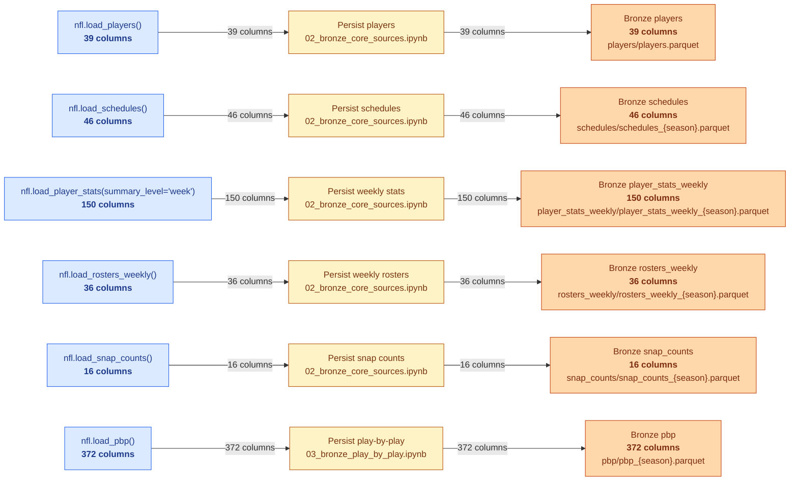

### Output Data Details

| Step | Joins and shared keys | Renamed or standardized | Derived or transformed | Not carried forward |
|---|---|---|---|---|
| `nflreadpy → Bronze` | No joins. | **0 intentional column renames.** | **0 feature-engineered columns.** DataFrames are converted from Polars to pandas and written to Parquet. | **0 columns intentionally removed.** Source column counts are preserved in Bronze. |

## 2. Bronze to player participation and weekly Silver

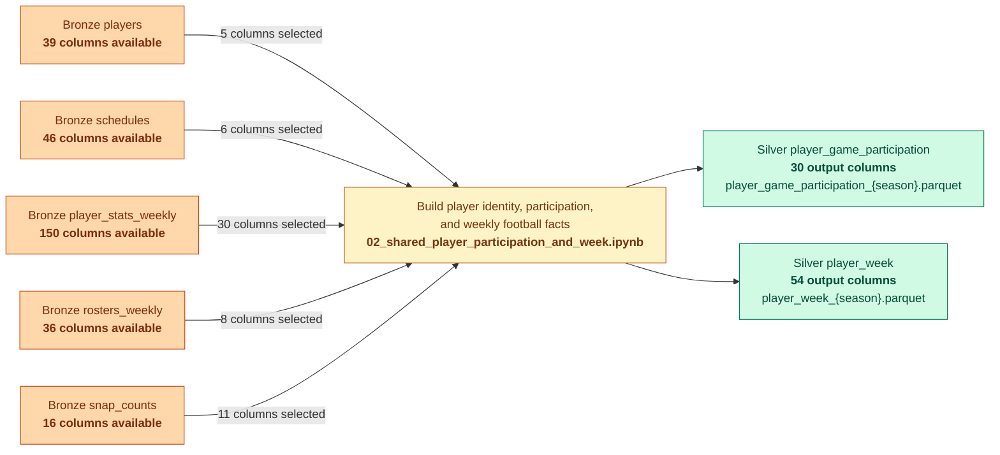

### Output Data Details

| Output | Joins and shared keys | Renamed or standardized | Derived or transformed | Not carried forward |
|---|---|---|---|---|
| `player_game_participation` — 30 columns | Stats and snaps combine on `player_id + game_id + team`. Schedule, roster, and player-master enrichment use their respective shared keys. | **14 columns renamed or disambiguated** — includes `gsis_id → player_id`, source-specific position prefixes, `st_snaps → special_teams_snaps`, and snap-percentage renames. **6 snap fields type-standardized.** | **9 columns derived** — `season_type`, seven source or participation flags, and one consolidated `display_name`. | **24 selected stat columns excluded** from this participation-only output. Join helpers and source-specific fallback names are also removed. |
| `player_week` — 54 columns | Uses the same joined observations at `player_id + season + week + team`; `game_id` remains an attribute. | **24 columns renamed or disambiguated** — 14 contextual fields plus 10 weekly-stat names such as `attempts → passing_attempts` and `targets → receiving_targets`. **30 numeric fields type-standardized** across stats and snaps. | **9 columns derived** — the same context, source-presence, participation, WR, and display-name fields used by the participation output. | **227 Bronze columns not selected** across the five input datasets. Source fantasy points, precomputed shares, and join-only helper fields are omitted. |

## 3. Bronze to standardized plays and team-week opportunity

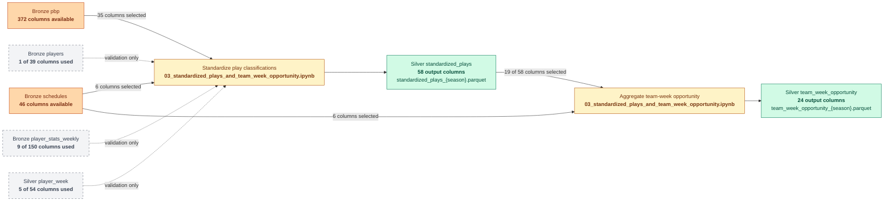

### Output Data Details

| Output | Joins and shared keys | Renamed or standardized | Derived or transformed | Not carried forward |
|---|---|---|---|---|
| `standardized_plays` — 58 columns | PBP joins to schedules on `game_id`; the `game_id + play_id` grain remains unchanged. | **20 columns renamed or standardized** — four canonical context names, 15 Boolean `source_*` flags, and integer `play_id`. | **22 columns derived** — 21 canonical `is_*` classifications plus `target_air_yards`; source `epa` and `success` pass through unchanged. | **377 source columns not selected** — 337 from PBP and 40 from schedules. All PBP rows remain despite the column reduction. |
| `team_week_opportunity` — 24 columns | Plays group on `game_id + team`, then join to schedule team-game rows. Final grain is `team + season + week`. | **16 aggregated fields renamed** with the `team_` prefix, such as `is_target → team_targets`. | **17 opportunity metrics aggregated** — 16 Boolean counts and one air-yard total. **16 count fields** are standardized to integer zero when missing. | **79 input columns not selected** — 39 from standardized plays and 40 from schedules. Play descriptions, player IDs, source EPA and success, and individual-play details disappear during aggregation. |

## 4. Shared Silver to WR weekly facts

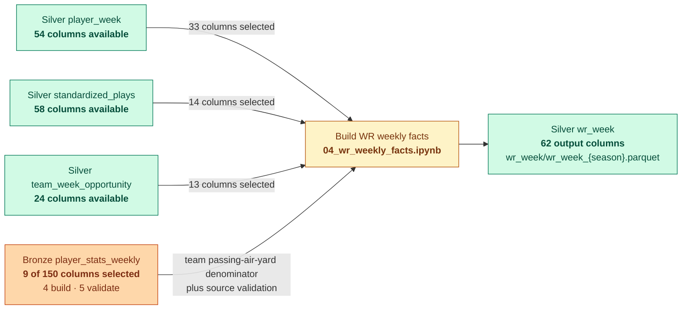

### Output Data Details

| Output dataset | Joins and shared keys | Renamed or standardized | Derived or transformed | Columns not carried forward | Grain changes or aggregation |
|---|---|---|---|---|---|
| `wr_week` — **62 verified columns** | Receiver and rusher aggregates join to WR rows on `player_id + game_id + team`. Shared team denominators—including `team_pass_attempts`—and the Bronze-derived passing-air-yard denominator join on `team + season + week`; `game_id` agreement is required for shared Silver. | **20 generated numeric columns standardized** — nine PBP counts use nullable integers; PBP target air yards, team passing air yards, and nine shares use nullable floats. **10 PBP fields are renamed as player opportunity aggregates.** | **20 columns derived or aggregated** — ten player-game opportunity fields, Bronze `passing_air_yards` aggregated to `team_passing_air_yards`, and nine same-week shares. `team_pass_attempts` is selected without redefining it. | **217 available input columns not selected** — 21 from `player_week`, 44 from standardized plays, 11 from team-week opportunity, and 141 from Bronze weekly stats. Five selected Bronze fields support validation but are not persisted directly. | The WR subset retains `player_id + season + week + team`; no aggregation changes the base output grain. PBP is aggregated from play to player-game-team, and passing air yards are aggregated from player-week to team-week before joining. |

## 5. Shared Silver to RB weekly facts

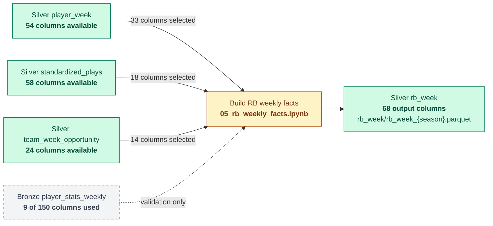

### Output Data Details

| Output dataset | Joins and shared keys | Renamed or standardized | Derived or transformed | Columns not carried forward | Grain changes or aggregation |
|---|---|---|---|---|---|
| `rb_week` — **68 verified columns** | Rusher and receiver aggregates join to contextual RB/FB rows on `player_id + game_id + team`. All-team denominators join on `team + season + week`; three contextual RB/FB backfield denominators are aggregated and joined at the same grain. `game_id` agreement is required for shared Silver. Bronze weekly stats are validation-only. | **25 generated numeric columns standardized** — nine PBP counts and three backfield denominators use nullable integers; PBP target air yards and 12 shares use nullable floats. **10 PBP fields are renamed as player opportunity aggregates.** | **25 columns derived** — ten player-game opportunity aggregates, three team-week RB/FB backfield denominators, and 12 same-week shares. | **71 schema-producing input columns not selected** — 21 from `player_week`, 40 from standardized plays, and 10 from team-week opportunity. The nine selected Bronze validation fields are not persisted. | The RB/FB subset retains `player_id + season + week + team`; no aggregation changes the base output grain. PBP is aggregated from play to player-game-team, while backfield denominators aggregate contextual RB/FB rows to team-week before the many-to-one join. |

## 6. Shared Silver to QB weekly facts

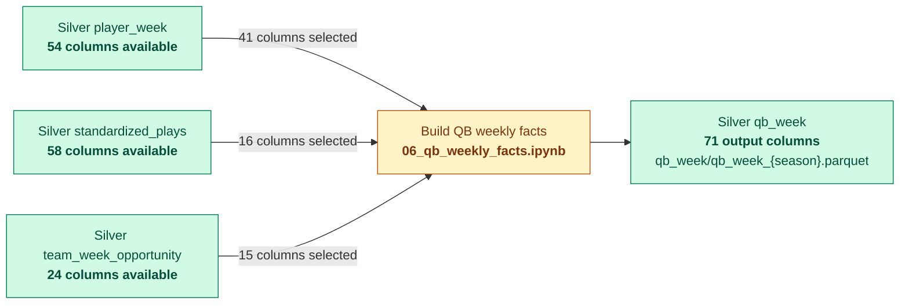

### Output Data Details

| Output dataset | Joins and shared keys | Renamed or standardized | Derived or transformed | Columns not carried forward | Grain changes or aggregation |
|---|---|---|---|---|---|
| `qb_week` — **71 verified columns** | Passer, rusher, and complete-dropback aggregates join to contextual QB rows on `player_id + game_id + team`. Team denominators join on `team + season + week`, with `game_id` agreement required. | **19 generated numeric columns standardized** — 12 PBP opportunity fields use nullable integers and seven shares use nullable floats. **12 PBP fields are named as QB passing, dropback, and rushing facts.** | **19 columns derived** — 12 player-game opportunity fields and seven same-week shares. Dropback identity combines passer IDs for attempts and sacks with rusher IDs for scrambles. | **64 schema-producing input columns not selected** — 13 from `player_week`, 42 from standardized plays, and nine from team-week opportunity. | The QB subset retains `player_id + season + week + team`; no aggregation changes the base output grain. PBP is aggregated from play to player-game-team before the one-to-one joins. |

## 7. WR weekly Silver to Draft season Gold

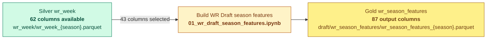

### Output Data Details

| Output dataset | Joins and shared keys | Renamed or standardized | Derived or transformed | Columns not carried forward | Grain changes or aggregation |
|---|---|---|---|---|---|
| `wr_season_features` — **87 verified columns** | Two player-season aggregates—team context and season totals—join one-to-one on `player_id + season`. No external dataset joins occur. | **4 columns renamed** — canonical PBP targets, target air yards, non-kneel rushes, and team target air yards receive reader-facing Gold names. **36 columns type-standardized** — 34 nullable integers, `season`, and the eligibility Boolean. | **84 columns aggregated or derived** — all output fields except `player_id`, `season`, and `display_name`, including team context, participation, totals, nine shares, eight efficiencies, nine per-game features, five scoring fields, eligibility, and ten percentiles. `team_pass_attempts_per_game` uses the player’s observed games. | **19 available Silver columns not selected.** Weekly identifiers, source positions, opponent context, and weekly shares do not persist at the player-season grain; selected weekly flags and keys are aggregated rather than copied. | Changes from `player_id + season + week + team` to one row per `player_id + season`. Only regular-season rows enter Gold, and multi-team seasons combine while retaining team history and final team. |

## 8. RB weekly Silver to Draft season Gold

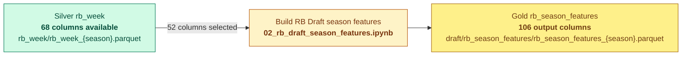

### Output Data Details

| Output dataset | Joins and shared keys | Renamed or standardized | Derived or transformed | Columns not carried forward | Grain changes or aggregation |
|---|---|---|---|---|---|
| `rb_season_features` — **106 verified columns** | Position/team context and season totals join one-to-one on `player_id + season`. No external dataset joins occur. | **5 columns renamed** — canonical non-kneel rushes, designed rushes, targets, target air yards, and team target air yards receive reader-facing Gold names. **47 columns type-standardized** — 45 nullable integers, `season`, and the eligibility Boolean. | **103 columns aggregated or derived** — all output fields except `player_id`, `season`, and `display_name`, including position/team context, participation, official and canonical workload, 12 shares, 12 efficiencies, 11 per-game features, five scoring fields, eligibility, and ten percentiles. | **16 available Silver columns not selected.** Weekly game context, opponent, snap percentage, team official rushes, and weekly shares do not persist at the player-season grain; selected weekly flags and validation fields are aggregated or reconciled rather than copied. | Changes from `player_id + season + week + team` to one row per `player_id + season`. Only regular-season rows enter Gold, and multi-team or multi-position seasons combine while retaining their observed paths. |

## 9. QB weekly Silver to Draft season Gold

### Output Data Details

| Output dataset | Joins and shared keys | Renamed or standardized | Derived or transformed | Columns not carried forward | Grain changes or aggregation |
|---|---|---|---|---|---|
| `qb_season_features` — **109 verified columns** | Position/team context and season totals join one-to-one on `player_id + season`. No external dataset joins occur. | **5 columns renamed** — completions, canonical pass attempts, canonical sacks, complete dropbacks, and canonical rush attempts receive reader-facing Gold names. **54 columns type-standardized** — 52 nullable integers, `season`, and the eligibility Boolean. | **106 columns aggregated or derived** — all output fields except `player_id`, `season`, and `display_name`, including team context, participation, official and canonical workload, seven shares, 12 efficiencies, 13 per-game features, six scoring fields, eligibility, and ten percentiles. | **12 available Silver columns not selected.** Weekly game type, opponent, snap percentage, receiving air-yard and yards-after-catch detail, and seven weekly shares do not persist at the player-season grain; selected weekly keys and flags are aggregated or reconciled rather than copied. | Changes from `player_id + season + week + team` to one row per `player_id + season`. Only regular-season rows enter Gold, and multi-team seasons combine while retaining their chronological team path and final team. |

## 10. WR weekly Silver to current-week Waiver Gold

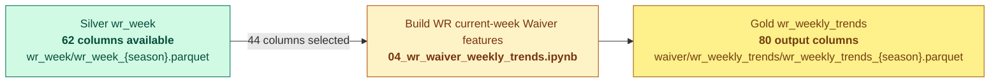

### Output Data Details

| Output dataset | Joins and shared keys | Renamed or standardized | Derived or transformed | Columns not carried forward | Grain changes or aggregation |
|---|---|---|---|---|---|
| `wr_weekly_trends` — **80 verified columns** | Player-week context and current-week totals join one-to-one on `player_id + season + week`. No external dataset joins occur. | **4 columns renamed** — canonical PBP targets, target air yards, non-kneel rushes, and team target air yards receive reader-facing Gold names. **36 columns type-standardized** — 34 nullable integers plus `season` and `week`. | **76 columns aggregated or derived** — all output fields except `player_id`, `season`, `week`, and `display_name`, including ordered game/team/opponent context, participation, totals, nine shares, eight efficiencies, nine per-game fields, and five scoring fields. | **18 available Silver columns not selected.** Postseason/type labels, source-position detail, snap percentage, unused official target and rush evidence, and persisted Silver share columns do not enter the output; shares are recomputed from selected components. | Changes from `player_id + season + week + team` to `player_id + season + week`. Only regular-season rows enter Gold. Current data has no duplicate player-weeks; future multi-record weeks aggregate while singular team/opponent fields become null. |

## 11. RB weekly Silver to current-week Waiver Gold

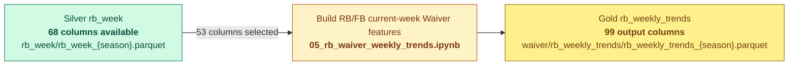

### Output Data Details

| Output dataset | Joins and shared keys | Renamed or standardized | Derived or transformed | Columns not carried forward | Grain changes or aggregation |
|---|---|---|---|---|---|
| `rb_weekly_trends` — **99 verified columns** | Player-week position/team context and current-week totals join one-to-one on `player_id + season + week`. No external dataset joins occur. | **5 columns renamed** — canonical non-kneel rushes, designed rushes, targets, target air yards, and team target air yards receive reader-facing Gold names. **47 columns type-standardized** — 45 nullable integers plus `season` and `week`. | **95 columns aggregated or derived** — all output fields except `player_id`, `season`, `week`, and `display_name`, including context, participation, official and canonical workload, 12 shares, 12 efficiencies, 11 per-game fields, and five scoring fields. | **15 available Silver columns not selected.** Postseason/type labels, snap percentage, unused official target and rush evidence, team official rushes, and persisted Silver share columns do not enter the output; shares are recomputed from selected components. | Changes from `player_id + season + week + team` to `player_id + season + week`. Only regular-season rows enter Gold. Current data has no duplicate player-weeks; future multi-record weeks aggregate while preserving ordered context. |

## 12. QB weekly Silver to current-week Waiver Gold

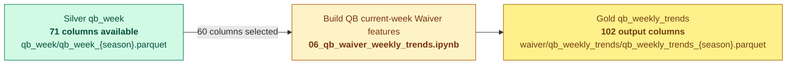

### Output Data Details

| Output dataset | Joins and shared keys | Renamed or standardized | Derived or transformed | Columns not carried forward | Grain changes or aggregation |
|---|---|---|---|---|---|
| `qb_weekly_trends` — **102 verified columns** | Player-week position/team context and current-week totals join one-to-one on `player_id + season + week`. No external dataset joins occur. | **5 columns renamed** — completions, canonical pass attempts, canonical sacks, complete dropbacks, and canonical rush attempts receive reader-facing Gold names. **54 columns type-standardized** — 52 nullable integers plus `season` and `week`. | **98 columns aggregated or derived** — all output fields except `player_id`, `season`, `week`, and `display_name`, including context, participation, official and canonical workload, seven shares, 12 efficiencies, 13 per-game fields, and six scoring fields. | **11 available Silver columns not selected.** Postseason/type labels, snap percentage, receiving air-yard and yards-after-catch detail, and persisted Silver share columns do not enter the output; shares are recomputed from selected components. | Changes from `player_id + season + week + team` to `player_id + season + week`. Only regular-season rows enter Gold. Current data has no duplicate player-weeks; future multi-record weeks aggregate while preserving ordered context. |
